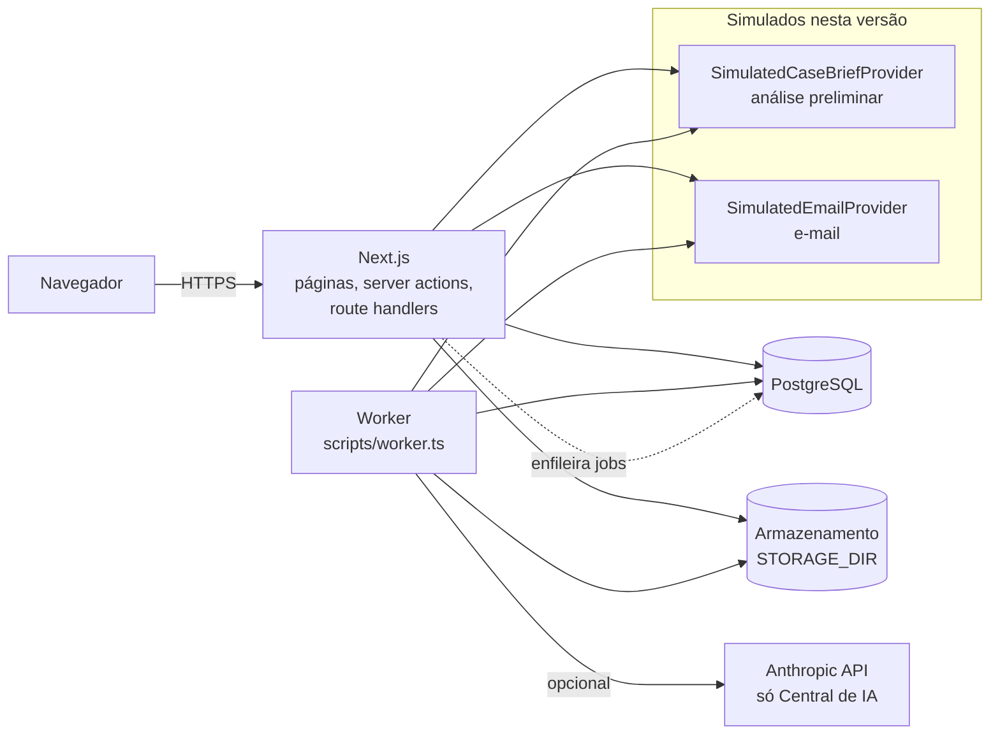
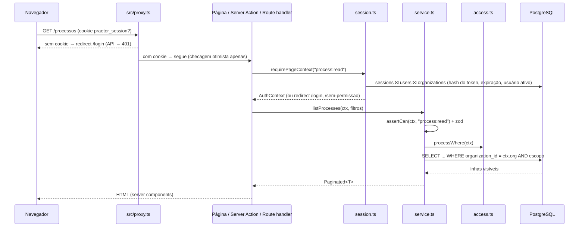
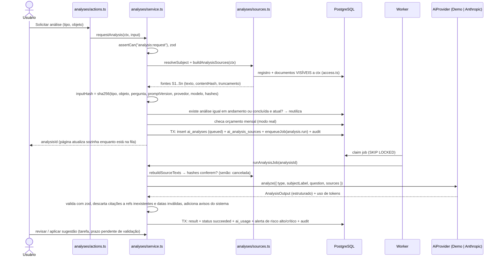

# Arquitetura

Praetor é uma aplicação Next.js 16 (App Router, TypeScript) monolítica com um processo de worker separado, ambos falando com o mesmo PostgreSQL. Não há serviços externos obrigatórios: a IA real da Central de IA (Anthropic) é opcional, o armazenamento de arquivos é local por padrão e, na v2, a análise preliminar e o e-mail são **simulações** atrás de interfaces (nenhuma chamada de rede). Não há integração com tribunais.



## Camadas

| Camada | Pasta | Responsabilidade | Pode importar |
|---|---|---|---|
| Rotas | `src/app/**` | Páginas, layouts, `route.ts`. Finas: obtêm o contexto da sessão e chamam serviços/ações. | módulos, `@/server/auth/session`, componentes |
| Ações | `src/modules/<d>/actions.ts` | `"use server"`. `requireActionContext(perm)` → serviço → `revalidatePath` → `ActionResult`. | serviço, sessão, `next/*` |
| Serviços | `src/modules/<d>/service.ts` (e `*-service.ts`) | Regras de negócio e persistência. Fronteira de confiança: valida com zod, `assertCan`, escopo de linhas, auditoria. | `@/server/*`, `@/domain/*`, outros serviços pelos contratos |
| Servidor | `src/server/**` | Banco, autenticação, permissões, visibilidade, integrações (IA, análise preliminar, e-mail, storage, extração), fila, auditoria, erros, logger. | — |
| Domínio | `src/domain/**` | Enums, rótulos pt-BR, contratos de saída da IA e da análise preliminar, regras puras de contingência (`contingency.ts`) e de número CNJ (`cnj.ts`). Client-safe. | apenas zod |
| UI | `src/components/**`, `src/modules/<d>/components/**` | Server components por padrão; `"use client"` só para interatividade. | componentes de cliente **nunca** importam `@/server/*` nem `service.ts` |

Regras completas e contratos entre módulos: [`docs/dev/MODULE_CONTRACTS.md`](dev/MODULE_CONTRACTS.md). Serviços não importam `next/*` nem `@/server/auth/session`, porque também rodam no worker e nos testes.

## Ciclo de uma requisição



1. **Proxy** (`src/proxy.ts`): só verifica se existe o cookie `praetor_session`. Não é autorização. Os uploads (`/api/documents/upload`, `/api/imports/upload`) e os arquivos públicos do logo (`/brand/*`) ficam fora do matcher.
2. **Sessão** (`src/server/auth/session.ts`): `requirePageContext(perm)` em páginas, `requireActionContext(perm)` em ações e `getCurrentUser()` em route handlers. A sessão é relida do banco a cada requisição (memoizada por requisição com `cache`), com perfil, unidade e escritório externo (`AuthContext.lawFirmId`).
3. **Serviço**: `assertCan(ctx, perm)` (permissão de ação) **e** o `*Where(ctx)` de `src/server/auth/access.ts` (visibilidade por linha) em toda consulta. Leituras unitárias usam `id AND escopo` e lançam `NotFoundError` quando não há resultado, sem revelar se o registro existe.
4. **Mutação**: `getDb().transaction(...)` com `recordAudit(ctx, ..., tx)` e, quando o registro é fonte de análises, `markAnalysesStaleForEntity(..., tx)`. Mudanças em valores, risco e garantias atualizam os espelhos do processo na mesma transação (`syncProcessMirrors`).
5. **Erros**: serviços lançam a família `AppError` (`src/server/lib/errors.ts`). Ações convertem com `toActionError` (mensagem pt-BR, sem detalhes internos). Route handlers mapeiam `code` para status HTTP. Erros inesperados vão para `error.tsx`, que mostra só um código de referência.

O layout `(app)/layout.tsx` chama `requirePageContext()` e carrega os dados do shell (`loadShellData`: organização, unidade, escritório, contagem de alertas, modo da IA e do e-mail), mas **não** é fronteira de autorização: layouts não re-renderizam na navegação, por isso cada página verifica a própria permissão.

## Módulos

| Módulo | Rotas | Conteúdo principal |
|---|---|---|
| `processes` | `/processos`, `/api/processes/export` | Carteira por número CNJ, instâncias, partes, movimentações manuais, saída da carteira ativa (RN-12), verificação, exportação CSV/XLSX, registro de acesso a sigilosos |
| `organization` (v2) | `/admin/empresas`, `/admin/escritorios` | Empresas do grupo e escritórios externos |
| `imports` (v2) | `/importacoes`, `/api/imports/**` | Importação da planilha: análise, inconsistências, divergências, confirmação idempotente, desfazer |
| `contingency` (v2) | `/contingencias/**`, `/acordos`, `/api/contingency/**` | Valores append-only, fila de conferência, garantias, risco, provisão, acordos, fechamento mensal, rotinas de pendências e de prévia |
| `hearings` (v2) | `/audiencias` | Audiências, agenda, rotina de alertas e lembrete por e-mail simulado |
| `alerts` | `/alertas` | Painel de alertas e pendências por área; produtores em cada módulo |
| `intake` (v2) | `/entrada/**` | Entrada de processos: cadastro, pipeline na fila, chegada simulada (demonstração) |
| `distribution` (v2) | `/distribuicao/**` | Regras de distribuição, atribuição de responsável, painel de carga |
| `briefs` (v2) | `/analises-preliminares/**` | Análise preliminar (gerada pelo provedor simulado), revisão, edição, aprovação, aplicação de sugestões, documentos fictícios de demonstração |
| `emails` (v2) | `/emails/**` | Central de e-mails simulados, modelos, reenvio, resumo diário sob demanda |
| `reports` (v2) | `/relatorios`, `/api/reports/**` | Seis relatórios, exportação CSV/XLSX, carta de auditoria |
| `preventive-intel` (v2) | `/inteligencia-preventiva` | Indicadores calculados da carteira e sugestões ilustrativas |
| `occurrences` | `/preventivo` | Ocorrências preventivas, plano de ação, origem "inteligência preventiva" |
| `contracts` | `/contratos` | Contratos, obrigações com recorrência, renovação e rescisão |
| `documents` | `/documentos`, `/api/documents/**` | Upload, versões, validação, extração de texto por página, download, PD-04 |
| `work` | `/prazos` | Prazos (manuais e sugeridos com validação), tarefas, calendário com audiências |
| `comments` | (embutido nas páginas) | Comentários em processos, ocorrências, contratos, documentos, tarefas, prazos e análises |
| `analyses` | `/ia`, `/ia/analises/[id]` | Central de IA (v1): análises e perguntas com provedor Demo ou Anthropic |
| `dashboard` | `/dashboard` | Painel executivo (carteira, exposição, comparação com competência fechada) e acompanhamento |
| `admin` | `/admin/**` | Usuários, equipes, unidades, permissões, auditoria (com CSV), configurações, integrações e saúde, rotinas |

Outras rotas: `/` (página pública), `/login`, `/busca` (busca global), `/sem-permissao`, `/api/health`.

## Processamento em segundo plano

Fila em PostgreSQL (tabela `jobs`), sem Redis. Ver [ADR-0004](adr/0004-postgres-job-queue.md).

- **Enfileirar**: `enqueueJob({ type, organizationId, payload, dedupeKey?, runAt?, maxAttempts? }, tx?)` em `src/server/jobs/queue.ts`. Pode ser chamado dentro da transação de negócio. Um `dedupeKey` com job pendente impede duplicatas.
- **Consumir**: `claimJobs` seleciona jobs vencidos com `FOR UPDATE SKIP LOCKED`, marca `running` e incrementa `attempts`. Vários workers podem rodar ao mesmo tempo.
- **Tipos de job** (`src/server/jobs/handlers.ts`):
  - `analysis.run` → `runAnalysisJob(analysisId, ...)`
  - `document.extract_text` → `extractDocumentVersionText(versionId)`, depois `onDocumentVersionTextReady(...)` (Central de IA) e `onDocumentTextReadyForBriefs(...)` (desatualiza análises preliminares)
  - `routine.run` → `runRoutine(routineId)`
  - `intake.process` (v2) → `processIntakeJob(intakeId, ...)` — pipeline da entrada de processos
  - `case_brief.generate` (v2) → `runCaseBriefJob(briefId, ...)` — análise preliminar pedida fora da entrada
- **Falhas e retentativas**: `failJob` reenfileira com backoff exponencial (30 s, 60 s, 120 s… até 30 min) enquanto `attempts < maxAttempts` (padrão 3) e o erro for retentável; senão, o job vira `dead`. `jobs.last_error` guarda só mensagens sanitizadas (`safeErrorMessage`).
- **Worker** (`src/server/jobs/worker.ts`, iniciado por `scripts/worker.ts`): em cada ciclo garante as rotinas padrão (a cada hora), recupera jobs presos há mais de 15 min (a cada minuto), agenda rotinas vencidas como jobs `routine.run` e processa até 10 jobs; se não havia nada, dorme `WORKER_POLL_INTERVAL_MS`.
- **Execução manual**: `processPendingJobs({ limit, organizationId? })` processa a fila inline ("Processar fila agora" na administração, seed e testes).

### Rotinas (`src/server/jobs/routines.ts`)

Por organização, com intervalo configurável em Administração → Configurações (mínimo 15 min na interface):

| Rotina | Intervalo padrão | O que faz |
|---|---|---|
| `deadline_alerts` | 60 min | Alertas de prazos vencidos, próximos e aguardando validação (sugeridos por análise de IA ou pela análise preliminar). Só prazos manuais ou validados contam como reais. |
| `contract_expiration_alerts` | 360 min | Contratos perto do fim ou do prazo de aviso e obrigações a vencer ou atrasadas. |
| `stale_analysis_refresh` | 1440 min | Conta análises desatualizadas; só reanalisa se `config.autoRefresh = true` (padrão `false`). |
| `retention_review` | 10080 min | **Apenas conta** registros elegíveis para revisão de exclusão. Nunca exclui. |
| `hearing_alerts` (v2) | 60 min | Um alerta por audiência na janela `alerts.upcomingHearingDays` (crítico para hoje e amanhã); encerra os que deixaram de valer; ao criar um alerta novo, gera um **e-mail simulado** `hearing_reminder` para o responsável (falha de e-mail não derruba a rotina). |
| `portfolio_alerts` (v2) | 360 min | Parcelas de acordo a vencer (`alerts.installmentDueDays`), valores aguardando conferência, execução sem valor apurado, garantia parada (`contingency.idleGuaranteeDays`) e processos a verificar. |
| `monthly_snapshot` (v2) | 1440 min | Gera ou atualiza a **prévia** da competência corrente com contexto de sistema; se ela já estiver fechada, não faz nada. Fechar é sempre ação humana. |

Não há rotina de resumo diário por e-mail: o resumo é gerado sob demanda em `/emails`.

## Fluxo da entrada de processos (v2)

```mermaid
sequenceDiagram
  actor U as Usuário (intake:manage)
  participant IS as intake/service
  participant PS as processes/service
  participant Q as Fila (jobs)
  participant WK as Worker
  participant DS as distribution/service
  participant BS as briefs/service
  participant CB as CaseBriefProvider (simulado)
  participant ES as emails/service
  participant EP as EmailProvider (simulado)
  U->>IS: registerIncomingProcess (ou "Simular chegada" na demonstração)
  IS->>PS: createProcess + addParty (contexto delegado se não houver process:write)
  U->>IS: documentos via /api/documents/upload, depois "iniciar"
  IS->>Q: case_intakes (received) + alerta new_process_received + auditoria + job intake.process
  WK->>IS: processIntakeJob(intakeId) com systemContext
  IS->>DS: 1. assignResponsible (mantém responsável; senão regras; senão menor carga)
  IS->>BS: 2. requestCaseBrief(inline) — extrai texto pendente, monta fontes visíveis
  BS->>CB: generate(record REG + documentos D1..Dn)
  CB-->>BS: CaseBrief com proveniência (sem IA)
  BS->>BS: sanitizeGeneratedBrief + avisos fixos + alerta brief_pending_review
  IS->>ES: 3. sendTemplatedEmail(case_brief_ready) — se autoNotify e notifyOnBriefReady
  ES->>EP: send (nada é entregue)
  U->>BS: revisão, edição por seção, aprovação ou rejeição (lido pela entrada)
```

- Cada etapa só roda se o resultado ainda não estiver gravado (`assignedToId`, `briefId`, `lastEmailId`), então retentativas não duplicam trabalho. Falhas viram uma etapa "falha" com mensagem saneada e o job é relançado pela fila.
- `settings.intake.autoAssign`, `autoGenerateBrief` e `autoNotify` (e `settings.email.notifyOnBriefReady`) podem interromper o pipeline na etapa correspondente; a tela `/entrada/[id]` oferece as ações manuais, que rodam na própria requisição.
- **Sem o worker**, o pipeline não avança (a tela fica "em andamento").
- A distribuição grava `legal_process.assign`; as etapas aparecem na linha do tempo da entrada com data, hora, autor e detalhe.

## Distribuição de demandas (v2)

- Regras (`distribution_rules`) avaliadas por prioridade crescente; a primeira cujos critérios casam com o processo e que tem ao menos um responsável ativo vence (`matching.ts`).
- Métodos: `fixed` (primeiro usuário ativo da lista), `round_robin` (cursor avançado dentro da transação, com a regra bloqueada) e `least_loaded` (menos processos ativos como responsável + entradas abertas).
- Sem regra aplicável: advogado ativo de menor carga da unidade do processo, senão de toda a organização. Processo com responsável já definido mantém o responsável (`kept`), salvo redistribuição.
- A regra pode também definir o escritório externo e a unidade do processo quando estiverem vazios.

## Análise preliminar e e-mail: provedores simulados

As duas integrações da v2 que dependeriam de serviços externos ficam atrás de interfaces e, nesta versão, só têm implementação simulada ([ADR-0010](adr/0010-simulated-integrations-behind-interfaces.md)):

| Integração | Interface | Implementação ativa | Seletor | Implementação futura |
|---|---|---|---|---|
| Análise preliminar | `CaseBriefProvider` (`src/server/integrations/ai/case-brief/provider.ts`) | `SimulatedCaseBriefProvider` (regras determinísticas, `mode = "demo"`) | `getCaseBriefProvider()` — sempre o simulado | `LiveCaseBriefProvider` (`live.ts`): existe e passa no typecheck, **não é selecionável** |
| E-mail | `EmailProvider` (`src/server/integrations/email/provider.ts`) | `SimulatedEmailProvider` (não abre conexão; recusa assunto sem "[Simulação]") | `getEmailProvider()` — sempre o simulado | nenhuma |

Contrato de saída da análise preliminar: `caseBriefSchema` (`src/domain/case-brief.ts`), com proveniência por item (extraído, cadastro, ilustrativo, lacuna, revisor). Detalhes, regras de rotulagem e o passo a passo para trocar cada provedor por um real em [AI.md](AI.md#análise-preliminar-de-processos) e [AI.md → e-mail](AI.md#como-trocar-o-e-mail-simulado-por-envio-real).

## Fluxo da análise de IA (Central de IA, v1)



Detalhes (prompts, dedupe, custo, staleness, gatilhos): [docs/AI.md](AI.md).

## Contingências: valores, risco e fechamento (v2)

- Toda conta de exposição e provisão usa as funções puras de `src/domain/contingency.ts` (`netExposure`, `provisionFor`, `addToBucket`): causa e liquidado nunca somados, nulo nunca é zero, estimativas sinalizadas.
- Valores e classificações de risco são append-only, com vigência por data; a competência fechada é imutável e lida dos itens armazenados ([ADR-0011](adr/0011-append-only-values-risk-vigency-monthly-close.md), [DATA_MODEL.md](DATA_MODEL.md#histórico-imutável-append-only)).
- "Posição em data passada" e os fechamentos usam o histórico oficial e substituído (`positionAt`); propostos e rejeitados nunca contam.

## Shell, navegação e busca (v2)

- Menu lateral agrupado (`NAV_GROUPS` em `src/lib/nav.ts`), filtrado por permissão no layout (`filterNavGroups`); o item ativo é a rota mais longa que casa (`activeNavHref`, `src/components/layout/nav-utils.ts`).
- Cabeçalho: busca global (`/busca`, que compõe os serviços de processos, documentos, contratos e ocorrências, cada um com sua permissão e visibilidade), sino de alertas, selos de e-mail simulado e do modo da IA, menu do usuário.
- Identidade visual: logo em SVG inline (`src/components/brand/`), com os traços da assinatura gerados de `public/brand/praetor-logo.svg` por `node scripts/generate-icons.mjs` (que também gera `favicon.ico` e `apple-icon.png`).

## Armazenamento de arquivos

- Interface `StorageProvider` em `src/server/integrations/storage/provider.ts`: `put`, `getStream`, `delete`, `exists`.
- Implementação atual: `LocalStorageProvider` (`local.ts`), com raiz em `path.resolve(STORAGE_DIR)`. A gravação é atômica (arquivo temporário criado com `wx` e depois `rename`), e há proteção contra path traversal.
- Chaves são geradas só no servidor por `buildStorageKey(orgId, id, versionId)` (UUIDs). O nome original do arquivo é apenas metadado. A planilha original de cada importação também é guardada com uma chave desse formato.
- O arquivo é gravado antes do commit da transação e removido se a transação falhar.
- Download apenas por rotas autenticadas (`/api/documents/[id]/versions/[versionId]/download`, `/api/imports/[id]/file`). Não existe URL pública.

## Como adicionar um módulo

Ver o checklist em [docs/dev/ADDING_A_MODULE.md](dev/ADDING_A_MODULE.md).

## Como trocar o provedor de IA

Vale para a Central de IA. A interface fica em `src/server/integrations/ai/provider.ts`:

```ts
export interface AiProvider {
  name: string;   // gravado em ai_analyses.provider
  model: string;  // gravado em ai_analyses.model
  mode: AiMode;   // "live" | "demo"
  analyze(req: AiAnalysisRequest): Promise<AiAnalysisResponse>; // { output: AnalysisOutput; usage }
}
```

Passo a passo:

1. Crie `src/server/integrations/ai/<provedor>.ts` com uma classe que implemente `AiProvider`.
2. Monte as mensagens **somente** com `buildSystemPrompt()` e `buildUserContent(req)` de `prompt.ts`. Elas fazem a neutralização do texto não confiável e os blocos `<source>`. Não concatene texto de documento de outra forma.
3. Peça saída estruturada no formato de `analysisOutputSchema` (`src/domain/analysis.ts`) e devolva o objeto validado. O serviço valida de novo e sanitiza as referências.
4. Mapeie erros para `AiProviderError(message, { retryable, userMessage })`. `message` é técnico e sem conteúdo; `userMessage` é o texto pt-BR exibido. Limite de taxa e indisponibilidade são retentáveis; credenciais, modelo inexistente e requisição inválida não.
5. Retorne `usage` (tokens de entrada e saída) e cadastre o preço do modelo em `pricing.ts` (`MODEL_PRICING`, US$ por milhão de tokens).
6. Registre a seleção em `getAiProvider()` (`index.ts`) e, se precisar, um novo valor em `AI_PROVIDER` (`src/server/env.ts`). Inclua na chave de cache tudo que muda o comportamento.
7. Se o texto do prompt ou o contrato de saída mudar, incremente `PROMPT_VERSION`. Ele faz parte do hash de deduplicação.
8. Testes: use `setAiProviderForTesting(provider)` para injetar o provedor (ver `tests/ai/`).

Análises em fila criadas com outro provedor ou modelo são **canceladas** na execução, com a mensagem "A configuração do provedor de IA mudou…", para nunca misturar resultados.

Para a análise preliminar e o e-mail, ver [AI.md](AI.md#como-ativar-a-ia-real-na-análise-preliminar) e [ADR-0010](adr/0010-simulated-integrations-behind-interfaces.md).

## Como trocar o armazenamento (S3 ou compatível)

1. Implemente `StorageProvider` (ex.: `s3.ts`): `put` com `PutObject` (o próprio objeto já é atômico), `getStream` devolvendo `ReadableStream<Uint8Array>` e lançando `StorageObjectNotFoundError` quando o objeto não existe, `delete` idempotente e `exists`.
2. Continue validando a chave com `assertValidStorageKey` e use o bucket como raiz. Nunca gere URLs públicas: o download deve continuar passando pela rota autenticada, que faz streaming do objeto. URLs pré-assinadas exigiriam rever as regras de [SECURITY.md](SECURITY.md).
3. Selecione o provedor em `getStorage()` (`src/server/integrations/storage/index.ts`) por variável de ambiente (exige alterar `src/server/env.ts`).
4. Habilite criptografia no servidor (SSE-KMS), versionamento e bloqueio de acesso público no bucket.
5. Migração de dados: copie `STORAGE_DIR/<org>/<id>/<versão>` para chaves idênticas no bucket. As chaves são as mesmas.
