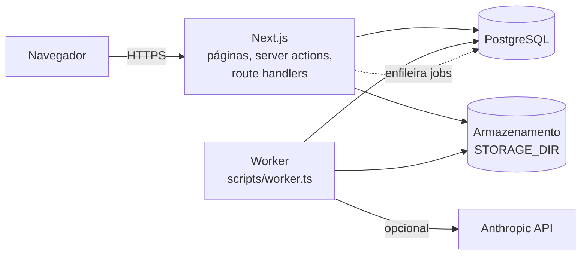
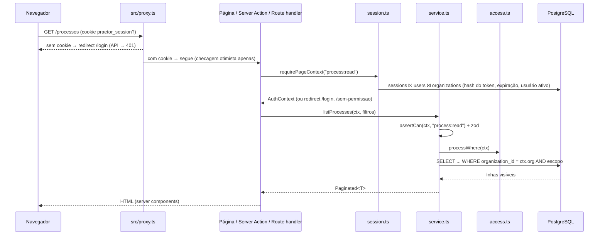
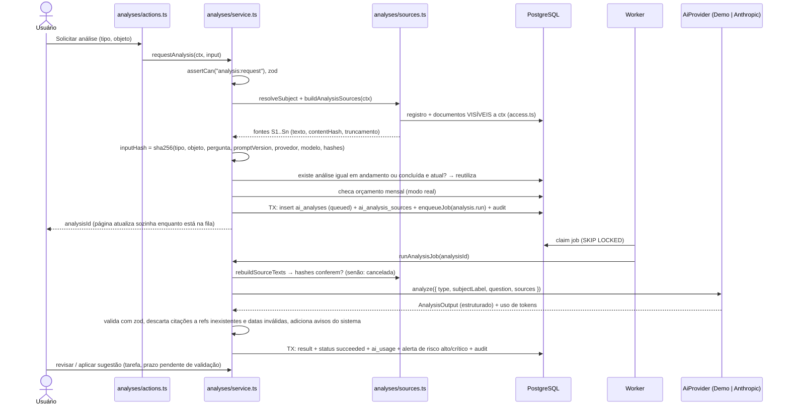

# Arquitetura

Praetor é uma aplicação Next.js 16 (App Router, TypeScript) monolítica com um processo de worker separado, ambos falando com o mesmo PostgreSQL. Não há serviços externos obrigatórios: a IA real (Anthropic) é opcional e o armazenamento de arquivos é local por padrão.



## Camadas

| Camada | Pasta | Responsabilidade | Pode importar |
|---|---|---|---|
| Rotas | `src/app/**` | Páginas, layouts, `route.ts`. Finas: obtêm o contexto da sessão e chamam serviços/ações. | módulos, `@/server/auth/session`, componentes |
| Ações | `src/modules/<d>/actions.ts` | `"use server"`. `requireActionContext(perm)` → serviço → `revalidatePath` → `ActionResult`. | serviço, sessão, `next/*` |
| Serviços | `src/modules/<d>/service.ts` | Regras de negócio e persistência. Fronteira de confiança: valida com zod, `assertCan`, escopo de linhas, auditoria. | `@/server/*`, `@/domain/*`, outros serviços pelos contratos |
| Servidor | `src/server/**` | Banco, autenticação, permissões, visibilidade, integrações, fila, auditoria, erros, logger. | — |
| Domínio | `src/domain/**` | Enums, rótulos pt-BR, schema da saída da IA, tipos compartilhados. Client-safe. | apenas zod |
| UI | `src/components/**`, `src/modules/<d>/components/**` | Server components por padrão; `"use client"` só para interatividade. | componentes de cliente **nunca** importam `@/server/*` nem `service.ts` |

Regras completas: [`docs/dev/MODULE_CONTRACTS.md`](dev/MODULE_CONTRACTS.md). Serviços não importam `next/*` nem `@/server/auth/session`, porque também rodam no worker e nos testes.

## Ciclo de uma requisição



1. **Proxy** (`src/proxy.ts`): só verifica se existe o cookie `praetor_session`. Não é autorização. O upload (`/api/documents/upload`) fica fora do matcher para o corpo não ser bufferizado.
2. **Sessão** (`src/server/auth/session.ts`): `requirePageContext(perm)` em páginas, `requireActionContext(perm)` em ações e `getCurrentUser()` em route handlers. A sessão é relida do banco a cada requisição (memoizada por requisição com `cache`), então mudanças de perfil, unidade ou desativação valem na próxima requisição.
3. **Serviço**: `assertCan(ctx, perm)` (permissão de ação) **e** o `*Where(ctx)` de `src/server/auth/access.ts` (visibilidade por linha) em toda consulta. Leituras unitárias usam `id AND escopo` e lançam `NotFoundError` quando não há resultado, sem revelar se o registro existe.
4. **Mutação**: `getDb().transaction(...)` com `recordAudit(ctx, ..., tx)` e, quando o registro é fonte de análises, `markAnalysesStaleForEntity(..., tx)`.
5. **Erros**: serviços lançam a família `AppError` (`src/server/lib/errors.ts`). Ações convertem com `toActionError` (mensagem pt-BR, sem detalhes internos). Route handlers mapeiam `code` para status HTTP. Erros inesperados vão para `error.tsx`, que mostra só um código de referência.

O layout `(app)/layout.tsx` também chama `requirePageContext()`, mas **não** é fronteira de autorização: layouts não re-renderizam na navegação, por isso cada página verifica a própria permissão.

## Módulos

| Módulo | Rotas | Conteúdo principal |
|---|---|---|
| `processes` | `/processos` | Processos, partes, movimentações manuais/importadas, criação a partir de ocorrência |
| `occurrences` | `/preventivo` | Ocorrências preventivas, vínculo com processo, progresso do plano de ação |
| `contracts` | `/contratos` | Contratos, obrigações, vigência (`vigencia.ts`) |
| `documents` | `/documentos`, `/api/documents/**` | Upload, versões, validação de arquivo, extração de texto, download |
| `work` | `/prazos` | Prazos (manuais e sugeridos pela IA com validação), tarefas, calendário |
| `comments` | (embutido nas páginas) | Comentários em processos, ocorrências, contratos, documentos, tarefas, prazos e análises |
| `alerts` | (dashboard) | Alertas gerados por rotinas e análises, com deduplicação |
| `analyses` | `/ia`, `/ia/analises/[id]` | Solicitação, execução, revisão e aplicação de análises de IA |
| `dashboard` | `/dashboard` | Indicadores agregados filtrados pelo escopo do usuário |
| `admin` | `/admin/**` | Usuários, equipes, unidades, permissões, auditoria, configurações, rotinas |

Outras rotas: `/login`, `/sem-permissao` (403 amigável), `/api/health`.

## Processamento em segundo plano

Fila em PostgreSQL (tabela `jobs`), sem Redis. Ver [ADR-0004](adr/0004-postgres-job-queue.md).

- **Enfileirar**: `enqueueJob({ type, organizationId, payload, dedupeKey?, runAt?, maxAttempts? }, tx?)` em `src/server/jobs/queue.ts`. Pode ser chamado dentro da transação de negócio, então o job só existe se a mudança for confirmada. Um `dedupeKey` com job pendente (`queued`/`running`) impede duplicatas (índice único parcial).
- **Consumir**: `claimJobs` seleciona jobs vencidos com `FOR UPDATE SKIP LOCKED`, marca `running` e incrementa `attempts`. Vários workers podem rodar ao mesmo tempo.
- **Tipos de job** (`src/server/jobs/handlers.ts`):
  - `analysis.run` → `runAnalysisJob(analysisId, ...)`
  - `document.extract_text` → `extractDocumentVersionText(versionId)` e depois `onDocumentVersionTextReady(...)`
  - `routine.run` → `runRoutine(routineId)`
- **Falhas e retentativas**: `failJob` reenfileira com backoff exponencial (30 s, 60 s, 120 s… até 30 min) enquanto `attempts < maxAttempts` (padrão 3) e o erro for retentável; senão, o job vira `dead`. Erros de domínio (`AppError`), payload inválido e erros com `retryable = false` (ex.: arquivo inexistente no armazenamento) não são retentados. `jobs.last_error` guarda só mensagens sanitizadas (`safeErrorMessage`), nunca parâmetros de consulta.
- **Worker** (`src/server/jobs/worker.ts`, iniciado por `scripts/worker.ts`): em cada ciclo
  1. a cada hora, garante as rotinas padrão de todas as organizações (`ensureDefaultRoutines`);
  2. a cada minuto, devolve à fila jobs presos em `running` há mais de 15 min (`recoverStuckJobs`);
  3. agenda rotinas vencidas (`claimDueRoutines` avança `next_run_at` atomicamente) como jobs `routine.run` com `dedupeKey` `routine:<id>`;
  4. processa até 10 jobs; se não havia nada, dorme `WORKER_POLL_INTERVAL_MS`.

  O script espera o banco ficar disponível e encerra com limpeza em SIGINT/SIGTERM.
- **Execução manual**: `processPendingJobs({ limit, organizationId? })` processa a fila inline. É usada pelo botão "Processar fila agora" (admin, restrito à organização do administrador), pelo seed e pelos testes.

### Rotinas (`src/server/jobs/routines.ts`)

Por organização, com intervalo configurável em Administração → Configurações (mínimo 15 min na interface):

| Rotina | Intervalo padrão | O que faz |
|---|---|---|
| `deadline_alerts` | 60 min | Alertas de prazos vencidos, próximos (janela `alerts.upcomingDeadlineDays`) e aguardando validação. Só prazos manuais ou validados contam como reais. Encerra alertas que deixaram de valer. |
| `contract_expiration_alerts` | 360 min | Alertas de contratos vigentes perto do fim ou do prazo de aviso (janela `alerts.contractExpirationDays`) e de obrigações a vencer ou atrasadas. |
| `stale_analysis_refresh` | 1440 min | Conta análises desatualizadas. Só solicita reanálises (até `maxPerRun`, respeitando o orçamento) se `config.autoRefresh = true`. O padrão é `false`. |
| `retention_review` | 10080 min | **Apenas conta** processos, ocorrências e documentos elegíveis para revisão de exclusão (respeitando `legalHold`). Nunca exclui nada. |

## Fluxo de análise de IA



Detalhes (prompts, dedupe, custo, staleness, gatilhos): [docs/AI.md](AI.md).

## Armazenamento de arquivos

- Interface `StorageProvider` em `src/server/integrations/storage/provider.ts`: `put`, `getStream`, `delete`, `exists`.
- Implementação atual: `LocalStorageProvider` (`local.ts`), com raiz em `path.resolve(STORAGE_DIR)`. A gravação é atômica (arquivo temporário criado com `wx` e depois `rename`), e há proteção contra path traversal: a chave deve casar `[a-f0-9-/]` e o caminho resolvido deve ficar dentro da raiz.
- Chaves são geradas só no servidor por `buildStorageKey(orgId, documentId, versionId)` (UUIDs). O nome original do arquivo é apenas metadado.
- O arquivo é gravado antes do commit da transação e removido se a transação falhar.
- Download apenas por `GET /api/documents/[id]/versions/[versionId]/download`, com autenticação e escopo de documento. Não existe URL pública.

## Como adicionar um módulo

Ver o checklist em [docs/dev/ADDING_A_MODULE.md](dev/ADDING_A_MODULE.md).

## Como trocar o provedor de IA

A interface fica em `src/server/integrations/ai/provider.ts`:

```ts
export interface AiProvider {
  name: string;   // gravado em ai_analyses.provider
  model: string;  // gravado em ai_analyses.model
  mode: AiMode;   // "live" | "demo"
  analyze(req: AiAnalysisRequest): Promise<AiAnalysisResponse>; // { output: AnalysisOutput; usage }
}
```

Passo a passo:

1. Crie `src/server/integrations/ai/<provedor>.ts` com uma classe que implemente `AiProvider`.
2. Monte as mensagens **somente** com `buildSystemPrompt()` e `buildUserContent(req)` de `prompt.ts`. Elas fazem a neutralização do texto não confiável e os blocos `<source>`. Não concatene texto de documento de outra forma.
3. Peça saída estruturada no formato de `analysisOutputSchema` (`src/domain/analysis.ts`) e devolva o objeto validado. O serviço valida de novo e sanitiza as referências.
4. Mapeie erros para `AiProviderError(message, { retryable, userMessage })`. `message` é técnico e sem conteúdo; `userMessage` é o texto pt-BR exibido. Limite de taxa e indisponibilidade são retentáveis; credenciais, modelo inexistente e requisição inválida não.
5. Retorne `usage` (tokens de entrada e saída) e cadastre o preço do modelo em `pricing.ts` (`MODEL_PRICING`, US$ por milhão de tokens).
6. Registre a seleção em `getAiProvider()` (`index.ts`) e, se precisar, um novo valor em `AI_PROVIDER` (`src/server/env.ts`, foundation). Inclua na chave de cache tudo que muda o comportamento.
7. Se o texto do prompt ou o contrato de saída mudar, incremente `PROMPT_VERSION`. Ele faz parte do hash de deduplicação.
8. Testes: use `setAiProviderForTesting(provider)` para injetar o provedor (ver `tests/ai/`).

Análises em fila criadas com outro provedor ou modelo são **canceladas** na execução, com a mensagem "A configuração do provedor de IA mudou…", para nunca misturar resultados.

## Como trocar o armazenamento (S3 ou compatível)

1. Implemente `StorageProvider` (ex.: `s3.ts`): `put` com `PutObject` (o próprio objeto já é atômico), `getStream` devolvendo `ReadableStream<Uint8Array>` e lançando `StorageObjectNotFoundError` quando o objeto não existe, `delete` idempotente e `exists`.
2. Continue validando a chave com `assertValidStorageKey` e use o bucket como raiz. Nunca gere URLs públicas: o download deve continuar passando pela rota autenticada, que faz streaming do objeto. URLs pré-assinadas exigiriam rever as regras de [SECURITY.md](SECURITY.md).
3. Selecione o provedor em `getStorage()` (`src/server/integrations/storage/index.ts`) por variável de ambiente (exige alterar `src/server/env.ts`).
4. Habilite criptografia no servidor (SSE-KMS), versionamento e bloqueio de acesso público no bucket.
5. Migração de dados: copie `STORAGE_DIR/<org>/<doc>/<versão>` para chaves idênticas no bucket. As chaves são as mesmas.
