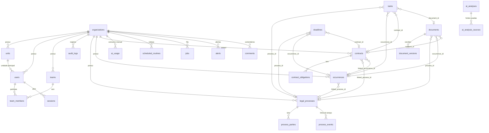

# Modelo de dados

PostgreSQL com Drizzle ORM. O schema é a fonte da verdade e fica em `src/server/db/schema/*.ts`, com 24 tabelas. As migrações SQL geradas ficam em `drizzle/` (a primeira é `0000_initial.sql`).

## Convenções

| Tema | Regra |
|---|---|
| Chaves | `id uuid` com `gen_random_uuid()` em todas as tabelas (exceto `sessions`, `team_members` e `ai_usage`). |
| Multi-organização | Toda tabela de dados de negócio tem `organization_id`. O valor sempre vem de `ctx.organizationId`, nunca da entrada do usuário. |
| Enums | Colunas `text` tipadas com `$type<...>()`. Valores válidos em `src/domain/enums.ts` e validados com zod nos serviços. Não há `CREATE TYPE` (ver [ADR-0003](adr/0003-enums-as-text.md)). |
| Dinheiro | Inteiro em **centavos** (`bigint`, BRL): `claim_amount_cents`, `provision_amount_cents`, `estimated_exposure_cents`, `value_cents`. Custos de IA em **micro-US$** (`cost_micro_usd`). |
| Datas de calendário | Colunas `date` lidas como string `"YYYY-MM-DD"` (prazos, vigência, datas processuais). Não sofrem fuso horário. |
| Instantes | `timestamptz` lidos como `Date`. A interface formata em `America/Sao_Paulo`. |
| Exclusão | **Exclusão lógica** (`deleted_at`) em processos, ocorrências, contratos, documentos, prazos, tarefas e comentários. Os builders de `access.ts` excluem linhas com `deleted_at`. Registros com `legal_hold = true` não podem ser excluídos. |
| Origem do dado | `data_origin`/`origin` (`manual`, `imported`, `ai_suggested`, `system`). A interface mostra com `OriginBadge`. A IA nunca cria processos, ocorrências ou contratos. |
| Timestamps | `created_at` e `updated_at` (atualizado pelo Drizzle em `$onUpdate`). |

## Diagrama de relacionamentos

Referências polimórficas (`entity_type` + `entity_id`, sem FK) existem em `comments`, `alerts`, `audit_logs` e `ai_analyses` (`subject_type` + `subject_id`). A visibilidade dessas linhas segue a entidade referenciada (`entityReferenceWhere`, `analysisWhere`).

## Tabelas

### Núcleo (`core.ts`)

| Tabela | Finalidade | Colunas-chave |
|---|---|---|
| `organizations` | Organização (tenant). | `slug` único; `is_demo` (exibe a faixa "Ambiente demonstrativo"); `settings` jsonb (`OrganizationSettings`: `ai.monthlyTokenBudget`, `ai.maxInputChars`, `ai.autoAnalyzeOnUpload`, `alerts.upcomingDeadlineDays`, `alerts.contractExpirationDays`, `retention.closedRecordRetentionDays`, `retention.auditLogRetentionDays`). |
| `units` | Unidades/filiais. Definem a visibilidade de advogados e analistas. | `name` único por organização; `is_active`. |
| `users` | Usuários. | `email` minúsculo e **único na instalação** (login por e-mail); `password_hash` (argon2id); `role`; `unit_id`; `is_active`; `last_login_at`. |
| `teams`, `team_members` | Equipes e membros (organizacional; não afeta a visibilidade nesta versão). | `leader_id`, `unit_id`; PK (`team_id`, `user_id`). |
| `sessions` | Sessões opacas. | `id` = SHA-256 do token (o token só existe no cookie); `expires_at`; `ip_address`; `user_agent`. |
| `audit_logs` | Trilha de auditoria append-only. | `action` (ex.: `legal_process.update`), `entity_type`/`entity_id`, `summary`, `changes` (diff com campos sensíveis protegidos), `metadata`, `actor_id`, `ip_address`. |

### Jurídico (`legal.ts`)

| Tabela | Finalidade | Colunas-chave |
|---|---|---|
| `legal_processes` | Processos (contencioso). | `number` (único por organização entre não excluídos; formato CNJ verificado só na forma), `court`, `court_division`, `jurisdiction`, `area`, `phase`, `status`, `risk_level`, `loss_probability`, `risk_rationale` (informado por pessoa), valores em centavos, `is_confidential`, `data_origin` (`manual`/`imported`) + `external_source`/`external_id`/`imported_at`, `legal_hold`, `responsible_id`, `unit_id`, `created_by_id`. |
| `process_parties` | Partes do processo. | `role` (polo ativo/passivo…), `document_number` (CPF/CNPJ só com dígitos; mascarado e nunca auditado), `is_client`, `counsel_name`. |
| `process_events` | Linha do tempo de movimentações. | `occurred_at` (date), `type`, `origin` (`manual`/`imported`, **nunca** gerado pela IA), `external_source`. |
| `occurrences` | Ocorrências do jurídico preventivo. | `facts`, `category`, `status` (`converted_to_process` só via vínculo), `risk_level`, `areas_involved` e `missing_information` (jsonb string[]), `estimated_exposure_cents`, `reported_by_id`, `occurred_on`/`reported_on`, `linked_process_id`, `resolved_at`, `is_confidential`, `legal_hold`. |
| `contracts` | Contratos. | `counterparty`, `counterparty_document`, `type`, `status`, `start_date`/`end_date`, `renewal_type`, `renewal_notice_days`, `value_cents`, `linked_process_id`, `linked_occurrence_id`, `is_confidential`, `legal_hold`. |
| `contract_obligations` | Obrigações contratuais. | `due_date`, `recurrence` (texto livre; sem motor de recorrência), `status` (o sistema não muda para `overdue` sozinho), `origin`, `source_analysis_id`. |

### Documentos (`documents.ts`)

| Tabela | Finalidade | Colunas-chave |
|---|---|---|
| `documents` | Documento lógico. Pode estar vinculado a no máximo um processo, uma ocorrência e um contrato. | `category`, `confidentiality` (`internal`/`confidential`/`restricted`), `process_id`/`occurrence_id`/`contract_id`, `current_version_id`/`current_version_number` (desnormalizados), `uploaded_by_id`, `retention_until`, `legal_hold`. |
| `document_versions` | Versões imutáveis do arquivo. | `version_number` (único por documento), `file_name` (sanitizado, só metadado), `mime_type` (**detectado pela assinatura**), `size_bytes`, `sha256`, `storage_key` (`<org>/<doc>/<versão>`), `extraction_status`, `extracted_text` (**conteúdo não confiável**, limite de 1.000.000 caracteres), `change_note`. |

### Trabalho (`work.ts`)

| Tabela | Finalidade | Colunas-chave |
|---|---|---|
| `deadlines` | Prazos. | `due_date`, `kind`, `status`, `priority`, `origin`, `validation_status` (`not_required` para manuais; `pending_validation` → `validated`/`rejected` para sugestões da IA), `validated_by_id`/`validated_at`/`validation_note`, `source_analysis_id`, `source_excerpt` (trecho literal da fonte), vínculos e `responsible_id`/`unit_id`. Só prazos `not_required` ou `validated` contam como reais. |
| `tasks` | Tarefas. `kind = action_plan` vinculada a uma ocorrência forma o plano de ação. | `status`, `priority`, `due_date`, `assignee_id`, `origin`, `source_analysis_id`, vínculos (inclui `document_id`). |
| `comments` | Comentários em qualquer entidade. | `entity_type`/`entity_id`, `author_id`, `body` (nunca logado nem auditado). |
| `alerts` | Alertas preventivos. | `type`, `severity`, `dedupe_key` (único entre alertas abertos), `resolved_at`/`resolved_by_id`. |

### IA e infraestrutura (`ai.ts`)

| Tabela | Finalidade | Colunas-chave |
|---|---|---|
| `ai_analyses` | Pedido e resultado de uma análise. | `type`, `subject_type`/`subject_id` (nulo só em perguntas à base), `question`, `status` (`queued` → `running` → `succeeded`/`failed`/`cancelled`), `trigger`, `mode` (`live`/`demo`), `provider`, `model`, `prompt_version`, `input_hash`, `result` (jsonb `AnalysisResult`), `error_message` (sanitizada), tokens e `cost_micro_usd`, `input_truncated`, revisão (`review_status`, `reviewed_by_id`, `review_note`), desatualização (`is_stale`, `stale_reason`, `stale_since`), `requested_by_id`. Índice único parcial em (`organization_id`, `input_hash`) para status `queued`/`running`. |
| `ai_analysis_sources` | Instantâneo das fontes usadas. | `ref` (`S1`…), `source_type` (`legal_process`, `occurrence`, `contract`, `document_version`), `entity_id` (para versões, o id do documento), `version_id`/`version_number`, `label`, `content_hash` (SHA-256 do texto exato enviado), `char_count`, `truncated`. O texto em si **não** é guardado. |
| `ai_usage` | Consumo mensal por organização (controle de orçamento). | PK (`organization_id`, `period` `YYYY-MM` UTC); `requests`, `input_tokens`, `output_tokens`, `cost_micro_usd`. |
| `jobs` | Fila de tarefas. | `type`, `payload`, `status` (`queued`/`running`/`succeeded`/`failed`/`dead`), `attempts`/`max_attempts`, `run_at`, `locked_at`/`locked_by`, `last_error` (sanitizado), `dedupe_key` (único entre pendentes). |
| `scheduled_routines` | Rotinas por organização. | `type` (único por organização), `enabled`, `interval_minutes`, `config`, `next_run_at`, `last_run_at`, `last_status` (resumo pt-BR), `last_error`. |

## Fontes de análise e desatualização

- Ao solicitar uma análise, o serviço monta as fontes visíveis ao solicitante, calcula `content_hash` de cada texto e grava as linhas de `ai_analysis_sources`.
- Na execução, o texto é **reconstruído** a partir do banco (versões de documento são imutáveis; registros são renderizados de novo) e os hashes são comparados. Se algo mudou, a análise é cancelada ("As fontes foram alteradas após a solicitação").
- Depois de concluída, uma análise vira `is_stale = true` (com `stale_reason`) quando:
  - um processo, ocorrência ou contrato usado como fonte é alterado nos campos relevantes (os serviços chamam `markAnalysesStaleForEntity` na mesma transação; processos também ao mudar partes e movimentações, contratos também ao mudar obrigações);
  - um documento usado ganha nova versão com texto extraído, ou um novo documento é vinculado ao registro analisado (`onDocumentVersionTextReady`). Análises que já incluem aquela versão não são marcadas;
  - metadados do documento mudam (vínculos, confidencialidade) ou o documento é excluído.
- Resultados desatualizados nunca são reescritos. A interface mostra o aviso e oferece "Solicitar nova análise".

## Fluxo de migrações

1. Altere `src/server/db/schema/*.ts`.
2. `npm run db:generate -- --name <descricao_da_mudanca>` gera `drizzle/NNNN_<nome>.sql` e atualiza `drizzle/meta/`.
3. Revise o SQL gerado (índices parciais, defaults, dados existentes).
4. `npm run db:migrate` aplica no banco de `DATABASE_URL`. Os testes aplicam todas as migrações automaticamente no PGlite (`tests/helpers/db.ts`).
5. Versione o SQL junto com o código. **Nunca edite uma migração já aplicada**: crie outra.

Adicionar um valor de enum não exige migração (coluna `text`). Renomear ou remover um valor exige migração de dados.
