# Modelo de dados

PostgreSQL com Drizzle ORM. O schema é a fonte da verdade e fica em `src/server/db/schema/*.ts`, com **64 tabelas** no schema `public` (24 da v1, 20 da v2 e 20 das migrações `0002` a `0013`) e o schema `bi`, só com visões para o Power BI. As migrações SQL ficam em `drizzle/` e, a partir da `0002`, cada uma tem o script de reversão em `drizzle/down/<tag>.sql` (ver [Migrações](#migrações-0000-a-0013)).

A regra que organiza o modelo, herdada do caderno de requisitos: **processo e parte são estado atual; valoração, classificação de risco, revisão de análise e fechamento mensal são histórico, e histórico não se altera** (ver [Histórico imutável](#histórico-imutável-append-only) e [ADR-0011](adr/0011-append-only-values-risk-vigency-monthly-close.md)).

## Convenções

| Tema | Regra |
|---|---|
| Chaves | `id uuid` com `gen_random_uuid()` em todas as tabelas (exceto `sessions`, `team_members` e `ai_usage`). |
| Multi-organização | Toda tabela de dados de negócio tem `organization_id`. O valor sempre vem de `ctx.organizationId`, nunca da entrada do usuário. |
| Enums | Colunas `text` tipadas com `$type<...>()`. Valores válidos em `src/domain/enums.ts` e validados com zod nos serviços. Não há `CREATE TYPE` (ver [ADR-0003](adr/0003-enums-as-text.md)). |
| Dinheiro | Inteiro em **centavos** (`bigint`, BRL), helper `cents()` em `legal.ts`. `null` significa "não informado / não apurado", **nunca zero** (RN-03). Custos de IA em **micro-US$** (`cost_micro_usd`). |
| Percentuais | Pontos-base inteiros (`5000` = 50%): `risk_percentage_bp`, `percentage_bp`. |
| Datas de calendário | Colunas `date` lidas como string `"YYYY-MM-DD"` (prazos, vigência, datas processuais, data-base de valores, vigência de risco). Não sofrem fuso horário. Competência mensal é texto `YYYY-MM`. |
| Instantes | `timestamptz` lidos como `Date`. A interface formata em `America/Sao_Paulo`. |
| Exclusão | **Exclusão lógica** (`deleted_at`) em processos, ocorrências, contratos, documentos, prazos, tarefas, comentários, garantias, acordos e audiências. Os builders de `access.ts` excluem linhas com `deleted_at`. Registros com `legal_hold = true` não podem ser excluídos. |
| Origem do dado | `data_origin`/`origin` (`manual`, `imported`, `ai_suggested`, `system`); valorações têm `source` própria (`document`, `official_system`, `spreadsheet`, `manual`, `simulation`). A interface mostra com `OriginBadge` e rótulos. Nem a IA nem a simulação criam processos, ocorrências ou contratos. |
| Timestamps | `created_at` e `updated_at` (atualizado pelo Drizzle em `$onUpdate`). |
| Referências sem FK | Para evitar ciclos de schema, algumas colunas não têm FK: `legal_processes.import_batch_id`, `process_instances.import_batch_id`, `process_valuations.document_version_id/import_batch_id/brief_id/supersedes_id`, `case_briefs.intake_id`, `case_intakes.brief_id/last_email_id`, `email_messages.brief_id/intake_id`, `inbound_requests.intake_id`, `snapshot_close_overrides.unclassified_process_ids` (lista jsonb). Os serviços validam a organização. |
| Dados públicos globais | `index_series`, `index_series_values` (séries do Banco Central) e `bi_labels` (rótulos pt-BR do BI) não têm `organization_id`: são iguais para todas as organizações e não contêm dados de clientes. |
| Imutabilidade no banco | Além das regras da aplicação, triggers do banco protegem os relatórios jurídicos (`0008`) e preenchem o índice padrão das valorações (`0007`). CHECKs do banco: fase do processo (`0012`), relatórios jurídicos e cenários (`0008`), ressalvas de fechamento (`0010`). |

## Diagrama de relacionamentos

```mermaid
erDiagram
  organizations ||--o{ units : possui
  organizations ||--o{ users : possui
  organizations ||--o{ companies : "empresas do grupo"
  organizations ||--o{ law_firms : "escritórios externos"
  law_firms ||--o{ users : "external_counsel"
  organizations ||--o{ teams : possui
  teams ||--o{ team_members : tem
  users ||--o{ team_members : participa
  units ||--o{ users : "unidade principal"
  users ||--o{ sessions : abre
  organizations ||--o{ audit_logs : registra

  organizations ||--o{ legal_processes : possui
  companies ||--o{ legal_processes : company_id
  law_firms ||--o{ legal_processes : law_firm_id
  legal_processes ||--o{ process_instances : "vínculos de grau"
  legal_processes ||--o{ process_parties : tem
  legal_processes ||--o{ process_events : "linha do tempo"
  legal_processes ||--o{ process_valuations : "valores (append-only)"
  legal_processes ||--o{ process_guarantees : garantias
  legal_processes ||--o{ process_risk_assessments : "risco (vigência)"
  legal_processes ||--o{ settlements : acordos
  settlements ||--o{ settlement_installments : parcelas
  legal_processes ||--o{ hearings : "audiências"
  legal_processes ||--o{ case_intakes : "entradas"
  legal_processes ||--o{ case_briefs : "análises preliminares"
  case_briefs ||--o{ case_brief_revisions : "revisões"
  case_briefs ||--o{ case_brief_sources : "fontes"
  organizations ||--o{ portfolio_snapshots : "fechamento mensal"
  portfolio_snapshots ||--o{ portfolio_snapshot_items : "posição por processo"
  organizations ||--o{ distribution_rules : regras
  distribution_rules ||--o{ case_intakes : distribution_rule_id
  organizations ||--o{ email_messages : "e-mails simulados"
  email_messages ||--o{ email_events : eventos
  organizations ||--o{ import_batches : "lotes de importação"
  import_batches ||--o{ import_rows : linhas
  portfolio_snapshots ||--o| snapshot_close_overrides : "ressalva do fechamento"
  legal_processes ||--o{ process_claims : "pedidos"
  process_claims ||--o{ process_claim_assessments : "avaliações (append-only)"
  process_risk_assessments ||--o| process_claim_risk_links : "derivada ou manual"
  legal_processes ||--o{ process_scenarios : "cenários"
  organizations ||--o{ legal_reports : "relatórios jurídicos"
  legal_reports ||--o{ legal_report_items : itens
  legal_reports ||--o{ legal_report_sources : fontes
  legal_reports ||--o| legal_reports : "supersedes_id"
  index_series ||--o{ index_series_values : "taxas mensais"
  organizations ||--o{ api_keys : "chaves de API"
  api_keys ||--o{ inbound_requests : "requisições"
  legal_processes ||--o| court_sync_states : "acompanhamento DataJud"
  organizations ||--o{ court_sync_runs : "execuções por tribunal"
  organizations ||--o| bi_settings : "Power BI"
  users ||--o{ bi_process_access : "acessos do BI"
  organizations ||--o{ bi_refresh_runs : "atualizações do BI"
  organizations ||--o{ bi_reader_roles : "usuários de leitura"

  organizations ||--o{ occurrences : possui
  occurrences }o--o| legal_processes : "linked_process_id"
  organizations ||--o{ contracts : possui
  contracts ||--o{ contract_obligations : tem
  contracts }o--o| legal_processes : "linked_process_id"
  contracts }o--o| occurrences : "linked_occurrence_id"

  documents ||--o{ document_versions : "versões"
  documents }o--o| legal_processes : process_id
  documents }o--o| occurrences : occurrence_id
  documents }o--o| contracts : contract_id

  deadlines }o--o| legal_processes : process_id
  tasks }o--o| legal_processes : process_id
  tasks }o--o| documents : document_id

  ai_analyses ||--o{ ai_analysis_sources : "fontes usadas"
  organizations ||--o{ ai_usage : "consumo mensal"
  organizations ||--o{ scheduled_routines : rotinas
  organizations ||--o{ jobs : fila
  organizations ||--o{ alerts : alertas
  organizations ||--o{ comments : "comentários"
```

Referências polimórficas (`entity_type` + `entity_id`, sem FK) existem em `comments`, `alerts`, `audit_logs`, `email_messages` e `ai_analyses` (`subject_type` + `subject_id`). A visibilidade dessas linhas segue a entidade referenciada (`entityReferenceWhere`, `analysisWhere`, `emailWhere`).

## Tabelas

### Núcleo (`core.ts`)

| Tabela | Finalidade | Colunas-chave |
|---|---|---|
| `organizations` | Organização (tenant). | `slug` único; `is_demo` (faixa de demonstração e "Simular chegada de processo"); `settings` jsonb (`OrganizationSettings`, sempre lido com `mergeOrganizationSettings`): `ai.*`, `alerts.upcomingDeadlineDays`, `alerts.contractExpirationDays`, **v2** `alerts.upcomingHearingDays` (10), `alerts.installmentDueDays` (10), `retention.*`, **v2** `contingency.riskPercentages` (remota 0, possível 50, provável 100), `contingency.confidenceThreshold` (85), `contingency.idleGuaranteeDays` (180), `contingency.rulesVersion`, `contingency.defaultCorrectionIndex` (`none`, migração `0007`), `email` (`mode: "simulated"` fixo, remetente fictício, `notifyOnBriefReady`, `notifyOnAssignment`), `intake` (`autoAssign`, `autoGenerateBrief`, `autoNotify`), `integrations.datajud` (`enabled` true, `syncIntervalHours` 24, `maxRequestsPerMinute` 20, `batchSize` 50, `autoApplyPhase` true, `enrichOnIntake` true; migração `0002`), `integrations.simulatedFeed` (`enabled` false, `intervalMinutes` 120), `legalReports` (`confidenceThreshold` 70, faixas de probabilidade 80/60/40/20/0, `legalBasisText`; migração `0008`). |
| `units` | Unidades/filiais. Definem a visibilidade de advogados e analistas. | `name` único por organização; `is_active`. |
| `companies` (v2) | Empresas (pessoas jurídicas) do grupo atendidas pelo jurídico (RNF-13). | `name` único por organização; `document` (CNPJ opcional, unicidade só verificada pela aplicação); `is_active`. |
| `law_firms` (v2) | Escritórios externos (RF-20/RF-21). | `name` único por organização; `document`; `contact_name`, `contact_email`; `is_active`. |
| `users` | Usuários. | `email` minúsculo e **único na instalação**; `password_hash` (argon2id); `role` (8 perfis); `unit_id`; **v2** `law_firm_id` (obrigatório para `external_counsel`, nulo para os demais); `is_active`; `last_login_at`. |
| `teams`, `team_members` | Equipes e membros (organizacional; não afeta a visibilidade). | `leader_id`, `unit_id`; PK (`team_id`, `user_id`). |
| `sessions` | Sessões opacas. | `id` = SHA-256 do token; `expires_at`; `ip_address`; `user_agent`. |
| `audit_logs` | Trilha de auditoria append-only. | `action` (ex.: `legal_process.update`), `entity_type`/`entity_id`, `summary`, `changes` (diff com campos sensíveis protegidos), `metadata`, `actor_id`, `ip_address`. |

### Jurídico (`legal.ts`)

| Tabela | Finalidade | Colunas-chave |
|---|---|---|
| `legal_processes` | Processos (contencioso). Um registro por número CNJ (RN-01). | `number` (único por organização entre não excluídos; 20 dígitos gravados no formato CNJ), `court`, `court_division`, `jurisdiction`, `area`, `phase`, `status`, `risk_level`, `risk_rationale`, `is_confidential`, `data_origin` + `external_source`/`external_id`/`imported_at`, `legal_hold`, `responsible_id`, `unit_id`, `created_by_id`. **v2**: `company_id`, `law_firm_id`, `instance` (atual), `process_class`, `city`, `state`, `phase_detail` (fase como veio da fonte), `closure_reason` (motivo de saída da carteira ativa, RN-12), `needs_verification` + `verification_note`, `last_movement_at`, `import_batch_id`. Valores: `claim_amount_cents` (valor da causa) e os **espelhos** `liquidated_amount_cents`, `risk_percentage_bp`, `loss_probability`, `provision_amount_cents` (ver abaixo). **P0.5**: `phase` só aceita `knowledge`, `liquidation` ou `enforcement` (CHECK `legal_processes_phase_ck`); recurso é `instance` (`first`/`second`/`superior` = 1º/2º/3º grau) e encerramento é `status`. Colunas da migração `0012_phase_instance_split`, usadas só para exibir o histórico e para a reversão: `legacy_phase` (fase anterior: `pre_filing`, `appeal`, `settlement` ou `closed`), `legacy_instance_set` (a migração preencheu `instance`) e `legacy_verification_set` (a migração ligou `needs_verification`). **`0002`**: `subjects` (jsonb, assuntos informados pelo DataJud). **`0013`**: índices por (`organization_id`, `city`), (`organization_id`, `process_class`), (`organization_id`, `import_batch_id`) e pela expressão dos dígitos do número CNJ (`regexp_replace(number, '[^0-9]', '', 'g')`, a mesma usada pela importação). |
| `process_instances` (v2) | Vínculos de instância (RN-01/RN-09): um por grau em que o processo tramitou ou tramita. | Único (`process_id`, `instance`); `court`, `court_division`, `city`, `state`, `process_class`, `phase`, `phase_detail`, `claim_amount_cents`, `liquidated_amount_cents` informados naquela instância; `is_current`; `origin`; `import_batch_id`, `source_sheet`, `source_row` (rastreio da planilha). **P0.5**: `phase` nulo ou uma das três fases (CHECK `process_instances_phase_ck`); `legacy_phase` guarda a fase anterior à migração `0012`. |
| `process_parties` | Partes do processo. | `role` (polo ativo, passivo, terceiro, **Ministério Público**, outro), `document_number` (CPF/CNPJ só com dígitos; mascarado e nunca auditado), `is_client`, **v2** `liability_nature` (direta, solidária, subsidiária; análise jurídica opcional), `counsel_name`. |
| `process_events` | Linha do tempo de movimentações. | `occurred_at` (date), `type`, `origin` (`manual`/`imported`, **nunca** gerado pela IA ou pela simulação), `external_source`; **v2** `cnj_movement_code` (informado por pessoa ou pelo DataJud; nunca inventado) e `instance`. **`0002`**: `external_id` (identificador da movimentação na fonte, código, data e grau) com índice único parcial (`process_id`, `external_source`, `external_id`): a mesma movimentação do DataJud nunca entra duas vezes. Movimentações do DataJud entram com `origin = imported`. |
| `occurrences` | Ocorrências do jurídico preventivo. | `facts` (na v2 pode terminar com o rodapé "Origem: inteligência preventiva [ref: pi:<chave>]"), `category`, `status`, `risk_level`, `areas_involved`, `missing_information`, `estimated_exposure_cents`, `linked_process_id`, `is_confidential`, `legal_hold`. |
| `contracts` | Contratos. | `counterparty`, `counterparty_document`, `type`, `status`, `start_date`/`end_date`, `renewal_type`, `renewal_notice_days`, `value_cents`, vínculos, `is_confidential`, `legal_hold`. |
| `contract_obligations` | Obrigações contratuais. | `due_date`; `recurrence` (v2: palavras canônicas mensal/trimestral/semestral/anual gravadas pelo módulo; texto livre é mantido; "Cumprir e gerar próxima" cria a próxima ocorrência com `origin = system`); `status` (o "em atraso" é calculado na leitura, não gravado); `origin`; `source_analysis_id`. |

### Contingências (`contingency.ts`, v2)

| Tabela | Finalidade | Colunas-chave |
|---|---|---|
| `process_valuations` | Valorações (RF-07/RF-09). **Append-only.** | `kind` (causa, liquidado, acordo, depósito, pago, honorários, estimativa), `amount_cents`, `base_date` (data a que o cálculo se refere), `instance`, `source`, `status` (`proposed` → `official` → `superseded`, ou `rejected`), `is_estimate` (RN-07), `reason`, rastreio documental (`document_id`, `document_version_id`, `page`, `excerpt` até 500 caracteres), `confidence` (0–100, extrações), `import_batch_id`, `brief_id`, `supersedes_id`, `created_by_id`, `reviewed_by_id` (obrigatório para oficial, RN-11), `reviewed_at`, `review_note`. Sem `updated_at`. **`0007`**: `correction_index` (`ipca_e`, `ipca`, `inpc`, `selic`, `tr`, `none`; nulo = "sem índice informado", linhas anteriores à migração); o trigger `process_valuations_default_correction_index` grava o índice padrão da organização quando o insert não informa. O valor atualizado **não** é coluna: é calculado na leitura. **`0013`**: `cleared_on` (data em que o valor da causa removido deixou de valer, gravada nas linhas substituídas pela remoção) e índice parcial por (`organization_id`, `import_batch_id`). |
| `process_guarantees` | Garantias e deduções (RF-10). | `kind` (depósito judicial e recursal, penhora, seguro garantia, carta de fiança, outra), `amount_cents`, `status` (`linked` abate a exposição; `released_to_plaintiff`, `returned_to_company`), `deposited_at`, `status_changed_at`, `document_id`, `origin`, exclusão lógica. |
| `process_risk_assessments` | Classificação de risco (RF-11/RF-12). **Append-only com vigência.** | `classification` (remota, possível, provável), `percentage_bp`, `opinion` (parecer obrigatório), `effective_from`, `status` (`official`; sugestões por regra nascem `proposed`), `origin`, `rules_version` (RNF-14), `assessed_by_id`, `reviewed_by_id`/`reviewed_at`. |
| `settlements` | Acordos. | `status` (proposta, negociação, firmado, homologado, cumprido, descumprido, cancelado), `total_amount_cents` (nulo = não definido), `installments_count`, `proposed_at`/`signed_at`/`homologated_at`, `notes`, `responsible_id`, exclusão lógica. |
| `settlement_installments` | Parcelas do acordo. | Único (`settlement_id`, `number`); `due_date`, `amount_cents`, `status` (a pagar, paga, cancelada), `paid_at`. |
| `portfolio_snapshots` | Fechamento mensal (RN-10). | Único (`organization_id`, `period` `YYYY-MM`); `reference_date` (último dia da competência); `status` (`preview` recalculável ou `closed` imutável); `metrics` jsonb (totais e quebras por tribunal, instância, fase, cidade, classificação, empresa e unidade; chave `"__none__"` para dimensão vazia e `"unclassified"` em classificação); `params` jsonb (percentuais e versão das regras usados); `generated_at`/`generated_by_id`; `closed_at`/`closed_by_id`. |
| `portfolio_snapshot_items` | Posição de cada processo na data-base (memória de cálculo). | `snapshot_id`, `process_id`, `number`, `company_id`, `unit_id`, `court`, `instance`, `phase`, `city`, `is_confidential`, `classification`, `percentage_bp`, `claim_amount_cents`, `liquidated_amount_cents`, `guarantees_cents`, `exposure_cents` + `exposure_is_estimate`, `provision_cents` + `provision_is_estimate`. Itens de competências fechadas antes da `0012` podem ter fase antiga (exibida com `processPhaseLabel`). |
| `snapshot_close_overrides` (`snapshot-close.ts`, migração `0010`) | Ressalva do fechamento: competência fechada com processos sem classificação de risco oficial na data-base. **Só inserção.** | Único por `snapshot_id`; `reason` (justificativa, CHECK de pelo menos 20 caracteres sem espaços nas pontas), `unclassified_process_ids` (jsonb), `unclassified_count` (CHECK > 0), `closed_by_id` (pessoa identificada), `created_at`. |

### Operação (`operations.ts`, v2)

| Tabela | Finalidade | Colunas-chave |
|---|---|---|
| `hearings` | Audiências e sessões de julgamento. Visibilidade herdada do processo. | `kind` (inicial, conciliação, instrução, una, sessão de julgamento, outra), `mode` (presencial, telepresencial, híbrida), `status` (designada, realizada, redesignada, cancelada), `scheduled_at`, `location`, `meeting_url` (informado por pessoa), `responsible_id`, `notes`, `outcome`, `origin`, exclusão lógica (sem exclusão pela interface). |
| `distribution_rules` | Regras de distribuição (RF-20), avaliadas por `priority` crescente; a primeira que casa vence. | `name`, `description`, `priority`, `is_active`, `criteria` jsonb (tribunais, áreas, empresas, unidades, UFs, cidades, instâncias, classes, faixa de valor da causa), `assignment` jsonb (`method` fixed/round_robin/least_loaded, `userIds`, `lawFirmId?`, `unitId?`), `rr_cursor` (posição do rodízio). |
| `case_intakes` | Entrada de processo (pipeline). Visibilidade herdada do processo. | `source` (cadastro manual, importação, chegada simulada), `status` (recebido → responsável definido → lendo documentos (simulação) → análise pronta → advogado notificado (e-mail simulado) → em revisão → aprovada; ou falha/cancelado), `received_at`, atribuição (`assigned_to_id`, `assignment_method`, `distribution_rule_id`, `assigned_law_firm_id`, `assigned_unit_id`, `assignment_reason`, `assigned_at`), `brief_id`, `last_email_id`, `steps` jsonb (etapas com data, detalhe em pt-BR sem texto de documento e autor), `error_message` (saneada). |

### Análise preliminar (`briefs.ts`, v2)

| Tabela | Finalidade | Colunas-chave |
|---|---|---|
| `case_briefs` | Análise preliminar de um processo. Uma linha por **versão** (`version` 1, 2, 3… por processo; regenerar cria nova linha). | Único (`process_id`, `version`); `status` (em processamento, pronta para revisão, em revisão, aprovada, rejeitada, falhou); `mode`/`provider`/`model`/`prompt_version` (nesta versão sempre o provedor simulado, `mode = demo`); `input_hash`; `original_content` (resultado da geração, **nunca muda**); `content` (versão vigente = última revisão); `current_revision`; `error_message` (saneada); aprovação e rejeição com autor, data e nota/motivo; `is_stale`/`stale_reason`. |
| `case_brief_revisions` | Histórico de edições (revisão 1 = conteúdo gerado). | Único (`brief_id`, `revision`); `content` completo; `edited_by_id` (nulo na revisão gerada); `change_note`. |
| `case_brief_sources` | Fontes usadas na geração. | `ref` (`REG` = cadastro; `D1`, `D2`… = versões de documento), `source_type`, `entity_id`, `version_id`/`version_number`, `label`, `content_hash`, `page_count`, `char_count`. O texto **não** é guardado aqui. |

### E-mail (`email.ts`, v2)

| Tabela | Finalidade | Colunas-chave |
|---|---|---|
| `email_messages` | E-mails gerados pelo sistema. **Todos `mode = simulated`**: renderizados e guardados para a Central de e-mails, nunca entregues. | `provider`, `template`, `status` (`simulated`, `failed`, `cancelled`), destinatário (`to_user_id`, `to_name`, `to_address`), remetente fictício, `subject`, `body_text`, `body_html` (podem conter dados do processo: **nunca logados nem auditados**), `link_url`, `entity_type`/`entity_id`, `process_id`, `brief_id`, `intake_id`, `provider_message_id` (`sim-…`), `error_message`, `triggered_by_id` (nulo = sistema), `sent_at`. |
| `email_events` | Eventos de cada mensagem. | `type` (`composed`, `simulated_delivery`, `viewed` = aberta na central, `failed`, `resent`), `detail`, `actor_id`. |

### Importação (`imports.ts`, v2)

| Tabela | Finalidade | Colunas-chave |
|---|---|---|
| `import_batches` | Lote de importação de planilha (RF-02): analisar → confirmar → (opcional) desfazer. | `company_id`, `default_unit_id`, `file_name`, `file_sha256`, `size_bytes`, `storage_key` (arquivo original), `status` (analisada, importada, desfeita, falhou), `sheets` jsonb (abas e papel de cada uma), `mapping` jsonb (colunas por aba, empresa, unidade, `unitByState`, distribuição após confirmar; o módulo também guarda ali a data-base escolhida e a sugerida), `stats` jsonb, `committed_by_id`/`committed_at`, `rolled_back_by_id`/`rolled_back_at`. |
| `import_rows` | Uma linha da planilha com normalização, problemas e ação resultante. | `sheet`, `row_number`, `cnj` (normalizado), `cnj_valid`, `action` (novo, atualiza, sem alteração, vínculo de instância, ignorada, erro), `issues` jsonb, `raw` (valores das células: dados fictícios ou da própria base do cliente, nunca logados), `normalized`, `process_id`, `before` (estado anterior dos campos, usado pelo desfazer). |

### Pedidos do processo (`claims.ts`, migração `0009`)

| Tabela | Finalidade | Colunas-chave |
|---|---|---|
| `process_claims` | Pedidos (verbas pleiteadas) de um processo. Exclusão lógica. | `description` (nunca vai para a auditoria), `category`, `claimed_amount_cents` (nulo = não quantificado, nunca zero), `amount_base_date`, `correction_index`, `instance`, `origin` (`manual`, `imported` ou `ai_suggested`), `status` (`confirmed`, `pending_confirmation`, `dismissed`), `source_brief_id` + `source_index` (único: um item da análise preliminar vira no máximo um pedido), `source_note` (versão, rótulo de simulação e referências, sem texto de documento), confirmação e descarte com autor e data, `deleted_at`. |
| `process_claim_assessments` | Avaliação de risco de um pedido. **Só inserção**, com vigência. | `claim_id`, `process_id`, `classification`, `percentage_bp`, `base_amount_cents` + `base_date` + `correction_index` (base guardada na avaliação; editar o pedido não a altera), `opinion`, `effective_from`, `rules_version`, `assessed_by_id` (obrigatório). Em vigor = maior `effective_from` até hoje, depois a mais recente. |
| `process_claim_risk_links` | Liga uma classificação de risco do processo aos pedidos. **Só inserção.** | `risk_assessment_id` (único), `kind` (`derived` ou `override`), resultado da derivação (`derived_classification`, `derived_percentage_bp`, `derived_provision_cents`, `quantified_base_cents`, `unquantified_count`, `unassessed_count`), `basis_fingerprint` (detecta mudança nas avaliações que contam), `created_by_id`. |

### Índices de correção (`indices.ts`, migração `0007`)

| Tabela | Finalidade | Colunas-chave |
|---|---|---|
| `index_series` | Catálogo das séries e situação da coleta (dado público global). | PK `code` (`ipca_e`, `ipca`, `inpc`, `selic`, `tr`), `name`, `sgs_code` (código da série no SGS do Banco Central), `last_month`, `last_fetched_at`, `last_attempt_at`, `last_error` (pt-BR saneado, nunca o corpo da resposta), `last_error_at`. |
| `index_series_values` | Taxa mensal de cada série. Um mês gravado nunca é reescrito (`on conflict do nothing`). | PK (`index_code`, `month` `YYYY-MM`), `rate_percent` (numeric 14,6), `source`, `fetched_at`. |

### Relatórios jurídicos (`legal-reports.ts`, migração `0008`)

| Tabela | Finalidade | Colunas-chave |
|---|---|---|
| `legal_reports` | Relatório emitido (uma linha por versão). | `type` (`process_report`, `provision_report`, `portfolio_report`, `responsibility_report`: R1 a R4), `reference` ("R1-2026-0007"; o documento de teste usa "TESTE-R1-…") + `reference_year` + `reference_number`, `title`, `is_sample`, `scope` jsonb + `process_id` (para a visibilidade), `base_date`, `parameters` jsonb (congelados na emissão), `status` (`draft`, `pending_review`, `approved`, `superseded`; CHECK), `version` (único por organização + referência + versão), `supersedes_id` (único: no máximo um sucessor), `generated_by_id` (nulo = sistema), `approved_by_id`/`approved_at` (CHECK: obrigatórios quando aprovado), `pdf_storage_key`, `pdf_sha256`, `pdf_size_bytes`. |
| `legal_report_sequences` | Numeração sequencial sem buracos. | PK (`organization_id`, `type`, `year`), `last_number`; o documento de teste usa a chave `sample:<tipo>`. |
| `legal_report_items` | Itens do relatório. | `section`, `position`, `content`, `origin` (`documented`, `record`, `inference`, `analysis`, `gap`; obrigatório, CHECK), documento, versão, página e `excerpt` (nunca para documento de saúde), `record_source` jsonb (tabela, campo, registro, data do registro), `derived_from`, `confidence` (0 a 100, CHECK), `simulated`, `pending_reason` (preenchido = item não afirmado, vai para "Pendências do relatório"), `data` (tabelas). |
| `legal_report_sources` | Fontes conferidas na emissão. | `reference` (D1…, C1…), `source`, `url`, documento, versão, página, `document_sha256`, `sensitive`, `checked_at`, `confirmed` (CHECK: sem confirmação exige `not_confirmed_reason`). |
| `process_scenarios` | Cenários de probabilidade de um processo. **Só inserção.** | `description`, `probability_band` (`very_high` a `very_low`, CHECK), `percent_min`/`percent_max` (0 a 100, dentro da faixa configurada; CHECK), `comment`, `origin` (`system` ou `manual`), `author_id`. |

Triggers da `0008`: um relatório emitido nunca muda de conteúdo; aprovado só passa a `superseded`, sem mudar mais nada; nenhum relatório é excluído; itens, fontes e cenários recusam UPDATE e DELETE.

### Integrações: API de entrada e DataJud (`integrations.ts`, migração `0002`)

| Tabela | Finalidade | Colunas-chave |
|---|---|---|
| `api_keys` | Chaves de API de sistemas externos. | `name`, `key_prefix` (para reconhecer a chave), `key_hash` (SHA-256, único; a chave nunca é guardada), `scopes` jsonb (`intake:create`, `process:read`), `created_by_id`, `last_used_at`/`last_used_ip` (atualizados no máximo uma vez por minuto), `revoked_at`/`revoked_by_id`, `expires_at`. |
| `inbound_requests` | Registro das requisições da API (idempotência e operação). **Nunca guarda o corpo.** | `api_key_id`, `idempotency_key` (único por chave quando informado), `request_hash` (SHA-256 do corpo), `endpoint`, `status` (`processing`, `accepted`, `updated_existing`, `duplicate`, `consulted`, `rejected`, `failed`), `http_status`, `process_id`, `intake_id`, `error_code` (código curto, sem dados). |
| `court_sync_states` | Situação de cada processo no acompanhamento do DataJud (uma linha por processo; apagada junto com o processo). | PK `process_id`, `source` (`datajud`), `status` (`pending`, `found`, `not_found`, `error`, `unsupported`), `last_checked_at`, `last_found_at`, `remote_updated_at`, `instances_found` jsonb (graus encontrados e os valores informados pelo tribunal, para só apontar divergência nova; um grau que não respondeu é mantido com `notReturnedSince`), `last_error` (saneado), `consecutive_errors`, `next_check_at` (intervalo e espera após falha). |
| `court_sync_runs` | Execuções da coleta, uma por tribunal e disparo. | `tribunal_alias` (ex.: `trt10`, `tst`), `trigger` (`routine`, `manual`, `intake`, `api`), `started_at`/`finished_at`, `status` (`running`, `succeeded`, `partial`, `failed`), contagens (`checked`, `found`, `not_found`, `new_movements`, `phase_changes`, `errors`), `error_message` (saneada), `duration_ms`. |

### Power BI (`bi.ts`, migrações `0003` e `0005`) e o schema `bi` (`0004`, `0006`, `0011`)

| Tabela | Finalidade | Colunas-chave |
|---|---|---|
| `bi_settings` | Configuração dos painéis e estado da atualização (uma linha por organização). | `workspace_id`, `reports` jsonb (relatórios publicados que o Praetor exibe), `rls_role` (padrão `AcessoPraetor`), `auto_refresh`, `config_updated_at`/`config_updated_by_id`, `access_refreshed_at`, `access_changed_at` (`0005`), `access_user_count`, `access_row_count`, `source_watermark_at`. Nenhum segredo. |
| `bi_process_access` | Processos que cada usuário ativo vê, calculados com `processWhere(ctx)` pela rotina `bi_access_refresh`. | PK (`user_id`, `process_id`), `user_key` (identidade usada no Power BI), `refreshed_at`. |
| `bi_refresh_runs` | Histórico das atualizações pedidas ao Power BI. | `trigger` (agenda, importação, fechamento, coleta, mudança de acessos, manual), `status` (`requested`, `succeeded`, `failed`, `skipped`), `dataset_id`, `message` (pt-BR), `request_id`, `requested_by_id`, `finished_at`. |
| `bi_labels` | Rótulos pt-BR dos códigos usados nas visões (global). | PK (`domain`, `code`), `label`. |
| `bi_reader_roles` | Organização lida por cada usuário de banco somente leitura (`0005`). | PK `role_name` (ex.: `praetor_bi`), `organization_id`. |

Visões do schema `bi` (`0006`, todas com `security_barrier = true` desde a `0011`): `processos`, `competencias` (só competências fechadas, como foram gravadas), `valoracoes`, `pendencias` (só contagens), `acesso`, `atualizacao` e `rotulos`. Valor da causa e valor apurado ficam em colunas separadas, nulo continua nulo, exposição e provisão apuradas e estimadas em colunas separadas; processos excluídos que constam de competência fechada continuam em `bi.processos` com `excluido = true`. Sem nomes de partes, CPF/CNPJ de pessoas ou texto de documentos. Cada visão filtra as linhas pela organização registrada em `bi_reader_roles` para o usuário que consulta (quem lê as tabelas do sistema vê tudo). Detalhes em [POWER_BI.md](POWER_BI.md).

### Documentos (`documents.ts`)

| Tabela | Finalidade | Colunas-chave |
|---|---|---|
| `documents` | Documento lógico. Pode estar vinculado a no máximo um processo, uma ocorrência e um contrato. | `category` (v2 inclui petição inicial, contestação, planilha de cálculos, sentença, acórdão, ata de audiência, alvará, termo de acordo, procuração e **atestado/laudo/CAT**), `confidentiality` (`internal`/`confidential`/`restricted`; categoria de saúde é sempre `restricted`), vínculos, `current_version_id`/`current_version_number`, `uploaded_by_id`, `retention_until`, `legal_hold`. |
| `document_versions` | Versões imutáveis do arquivo. | `version_number`, `file_name`, `mime_type` (**detectado pela assinatura**), `size_bytes`, `sha256`, `storage_key`, `extraction_status`, `extracted_text` (**conteúdo não confiável**, até 1.000.000 caracteres), **v2** `page_count` e `page_offsets` (jsonb: posição em que cada página começa no texto, para citar "página N"), `change_note`. |

### Trabalho (`work.ts`)

| Tabela | Finalidade | Colunas-chave |
|---|---|---|
| `deadlines` | Prazos. | `due_date`, `kind`, `status`, `priority`, `origin`, `validation_status` (`not_required` para manuais; `pending_validation` → `validated`/`rejected` para sugestões), `validated_by_id`/`validated_at`/`validation_note`, `source_analysis_id` (na v2: id de análise de IA **ou** de análise preliminar), `source_excerpt` (trecho literal), vínculos e `responsible_id`/`unit_id`. Só prazos `not_required` ou `validated` contam como reais. |
| `tasks` | Tarefas. `kind = action_plan` vinculada a uma ocorrência forma o plano de ação. | `status`, `priority`, `due_date`, `assignee_id`, `origin`, `source_analysis_id` (análise de IA ou preliminar), vínculos (inclui `document_id`). |
| `comments` | Comentários em qualquer entidade. | `entity_type`/`entity_id`, `author_id`, `body` (nunca logado nem auditado). |
| `alerts` | Alertas. | `type` (v2: audiência próxima, parcela de acordo a vencer, valor aguardando conferência, execução sem valor apurado, garantia parada, processo pendente de conferência, análise preliminar aguardando revisão, entrada sem responsável, novo processo recebido; depois: movimentação relevante, audiência designada e falha da coleta no DataJud, classificação de risco a rever pelos pedidos, processo sem classificação que impede o fechamento), `severity`, `entity_type`/`entity_id`, `dedupe_key` (único entre alertas abertos), `resolved_at`/`resolved_by_id`. |

### IA e infraestrutura (`ai.ts`)

| Tabela | Finalidade | Colunas-chave |
|---|---|---|
| `ai_analyses` | Pedido e resultado de uma análise da Central de IA. | `type`, `subject_type`/`subject_id`, `question`, `status`, `trigger`, `mode` (`live`/`demo`), `provider`, `model`, `prompt_version`, `input_hash`, `result` (jsonb `AnalysisResult`), `error_message`, tokens e `cost_micro_usd`, `input_truncated`, revisão, desatualização, `requested_by_id`. Índice único parcial em (`organization_id`, `input_hash`) para status `queued`/`running`. |
| `ai_analysis_sources` | Instantâneo das fontes usadas. | `ref` (`S1`…), `source_type`, `entity_id`, `version_id`/`version_number`, `label`, `content_hash`, `char_count`, `truncated`. O texto **não** é guardado. |
| `ai_usage` | Consumo mensal por organização. | PK (`organization_id`, `period` `YYYY-MM` UTC); `requests`, `input_tokens`, `output_tokens`, `cost_micro_usd`. |
| `jobs` | Fila de tarefas. | `type` (v2 inclui `intake.process` e `case_brief.generate`; depois `court_sync.run`, `bi.refresh` e `import.distribute`), `payload`, `status`, `attempts`/`max_attempts`, `run_at`, `locked_at`/`locked_by`, `last_error` (sanitizado), `dedupe_key` (único entre pendentes). |
| `scheduled_routines` | Rotinas por organização. | `type` (único por organização; v2 inclui `hearing_alerts`, `portfolio_alerts`, `monthly_snapshot`; depois `court_sync`, `simulated_feed`, `bi_access_refresh`, `index_series_refresh`), `enabled`, `interval_minutes`, `config`, `next_run_at`, `last_run_at`, `last_status`, `last_error`. |

## Espelhos no processo

Para listas e filtros rápidos, `legal_processes` guarda cópias desnormalizadas do histórico de contingências. Elas são recalculadas por `syncProcessMirrors` (`@/modules/contingency/internal`), sempre na mesma transação da mudança, chamada pelo serviço de contingências, pelos pedidos (classificação derivada) e pelo serviço de processos (valor da causa), e pela confirmação e pelo desfazer da importação (para todo processo que tocam):

- `liquidated_amount_cents` = última valoração **oficial** de liquidado (por data-base, depois a mais recentemente conferida); nulo = não apurado;
- `claim_amount_cents` = última valoração oficial de causa (mantido quando não há). No formulário do processo, quem tem `contingency:approve` grava uma valoração oficial de causa (as anteriores ficam substituídas); os demais geram uma valoração **proposta** e o espelho só muda quando ela é aprovada na conferência;
- `risk_percentage_bp` / `loss_probability` = classificação oficial **vigente hoje**;
- `provision_amount_cents` = `provisionFor(...)` considerando as garantias vinculadas.

`createProcess`/`updateProcess` ignoram `provision_amount_cents` e `loss_probability`. Valor da causa e liquidado **nunca** são somados (RN-02). O valor atualizado por índice nunca é espelhado nem somado.

## Histórico imutável (append-only)

| Dado | Regra | Onde é garantida |
|---|---|---|
| Valorações (`process_valuations`) | O valor nunca é atualizado. Nova apuração = novo registro; a oficial anterior do mesmo tipo e instância passa a `superseded`. Só `status` e campos de conferência mudam (auditados). Correção na conferência = original `rejected` + nova oficial com `supersedes_id`. Quitação (RN-06) = nova valoração de liquidado igual a zero com motivo "Quitação". No máximo uma oficial por (processo, tipo, instância). | `modules/contingency/service.ts` |
| Classificações de risco (`process_risk_assessments`) | Nova classificação = novo registro com `effective_from`; a vigente numa data é a oficial de maior `effective_from` ≤ data. Sugestão por regra nasce `proposed` e nunca vale sozinha; aprová-la muda o status para `official`, a vigência para a data da aprovação e o prefixo do parecer ("aprovada por <nome> em <data>"); a classificação e o percentual não mudam. | `modules/contingency/risk-service.ts` |
| Fechamento mensal (`portfolio_snapshots` + itens) | `preview` pode ser recalculada (itens refeitos); `closed` é **imutável**: gerar ou fechar de novo é recusado, e um fechamento concorrente nunca tem os itens tocados. Meses futuros são recusados. Relatórios de competência fechada leem os itens armazenados, nunca recalculam (RN-10). | `modules/contingency/snapshot-service.ts` |
| Revisões da análise preliminar (`case_brief_revisions`) | `original_content` nunca muda; cada edição grava uma nova revisão completa (a 1 é o conteúdo gerado) e itens alterados recebem a proveniência "Incluído/editado pelo advogado". Análise aprovada ou rejeitada não é mais editada; regenerar cria nova versão (nova linha em `case_briefs`). | `modules/briefs/service.ts` |
| Trilha de auditoria (`audit_logs`) | Append-only na aplicação (sem função de edição). Sem proteção no banco. | `server/services/audit.ts` |
| Versões de documento | Imutáveis; nova versão = novo registro com hash; versão idêntica à atual é rejeitada. | `modules/documents/service.ts` |
| Índice de uma valoração oficial | Trocar o índice de um valor oficial cria uma **nova** valoração oficial (mesmo tipo, valor, data-base, instância e fonte; `supersedes_id` = a anterior), e a anterior fica substituída com o índice antigo. Recusada quando outra instância tem valor do mesmo tipo e data-base, ou quando mudaria o valor em vigor. | `modules/indices/service.ts`, `modules/indices/swap-guard.ts` |
| Avaliações de pedidos e vínculos com o risco (`process_claim_assessments`, `process_claim_risk_links`) | Só inserção. Nova avaliação = novo registro com vigência; a classificação derivada é sempre uma nova classificação oficial do processo. | `modules/claims/service.ts` |
| Ressalva do fechamento (`snapshot_close_overrides`) | Só inserção, uma por competência, na mesma transação do fechamento. | `modules/contingency/snapshot-service.ts` |
| Relatórios jurídicos (`legal_reports` + itens, fontes, cenários) | Conteúdo emitido nunca muda; nova versão = nova linha com a mesma referência; nada é excluído. **Garantido também no banco** (triggers da `0008`). | `modules/legal-reports/service.ts` + triggers |
| Séries de índices (`index_series_values`) | Mês gravado nunca é reescrito. | `modules/indices/service.ts` |

Fora dos relatórios jurídicos, essas regras são da aplicação: o banco não impede um `UPDATE` direto. Ver [ADR-0011](adr/0011-append-only-values-risk-vigency-monthly-close.md).

## Fontes de análise e desatualização

- Ao solicitar uma análise da Central de IA, o serviço monta as fontes visíveis ao solicitante, calcula `content_hash` de cada texto e grava as linhas de `ai_analysis_sources`. A análise preliminar faz o mesmo em `case_brief_sources`.
- Na execução, o texto é **reconstruído** a partir do banco e os hashes são comparados. Se algo mudou, a análise é cancelada ("As fontes foram alteradas após a solicitação").
- Depois de concluída, uma análise vira `is_stale = true` (com `stale_reason`) quando:
  - um processo, ocorrência ou contrato usado como fonte é alterado nos campos relevantes (os serviços chamam `markAnalysesStaleForEntity` na mesma transação);
  - um documento usado ganha nova versão com texto extraído, ou um novo documento é vinculado ao registro analisado;
  - metadados do documento mudam (vínculos, confidencialidade) ou o documento é excluído.
- Análises preliminares ficam desatualizadas quando um documento do processo ganha texto novo, é excluído ou muda de vínculo (`markCaseBriefsStale`).
- Resultados desatualizados nunca são reescritos. A interface mostra o aviso e oferece uma nova análise ou versão.

## Migrações (0000 a 0013)

| Migração | O que faz | Reversão |
|---|---|---|
| `0000_initial` | Schema da v1. | sem script |
| `0001_v2_portfolio` | v2: tabelas e colunas novas, só adições. | sem script |
| `0002_court_sync_inbound_api` | `api_keys`, `inbound_requests`, `court_sync_states`, `court_sync_runs`; `legal_processes.subjects`; `process_events.external_id` + índice único; padrão de `settings.integrations`. | `drizzle/down/0002_…` |
| `0003_bi_tables` | `bi_settings`, `bi_process_access`, `bi_refresh_runs`, `bi_labels`. | `drizzle/down/0003_…` |
| `0004_bi_reporting_views` | Schema `bi` com as visões da primeira versão. | `drizzle/down/0004_…` |
| `0005_bi_access_scope` | `bi_reader_roles`; `bi_settings.access_changed_at`. | `drizzle/down/0005_…` |
| `0006_bi_reporting_views_v2` | Recria as visões com filtro por organização e as linhas de competências fechadas. | `drizzle/down/0006_…` |
| `0007_correction_index_series` | `index_series`, `index_series_values`; `process_valuations.correction_index` + trigger do índice padrão; padrão de `settings.contingency.defaultCorrectionIndex`. | `drizzle/down/0007_…` |
| `0008_legal_reports` | Tabelas dos relatórios jurídicos e cenários, CHECKs e triggers de imutabilidade; padrão de `settings.legalReports`. | `drizzle/down/0008_…` |
| `0009_process_claims` | `process_claims`, `process_claim_assessments`, `process_claim_risk_links`. | `drizzle/down/0009_…` |
| `0010_snapshot_close_overrides` | `snapshot_close_overrides`. | `drizzle/down/0010_…` |
| `0011_bi_views_security_barrier` | `security_barrier = true` em todas as visões do schema `bi`. | `drizzle/down/0011_…` |
| `0012_phase_instance_split` | Fase e instância separadas: converte as fases antigas, guarda `legacy_phase` e as marcas da migração, CHECK de fase, auditoria por processo. | `drizzle/down/0012_…` |
| `0013_process_detail_indexes` | `process_valuations.cleared_on`; índices de cidade, classe, lote de importação e dígitos do número CNJ. | `drizzle/down/0013_…` |

A reversão roda com `npm run db:rollback -- <tag> --yes` e só desfaz a **última** migração aplicada ([OPERATIONS.md](OPERATIONS.md#migrações)). Antes de reverter as migrações do Power BI (`0003` a `0006` e `0011`), remova os usuários de leitura ([POWER_BI.md](POWER_BI.md#7-desfazer)).

## Fluxo de migrações

1. Altere `src/server/db/schema/*.ts`.
2. Com outras pessoas ou agentes trabalhando no mesmo diretório, crie a trava `mkdir .data/locks/db-generate` antes de gerar e remova (`rmdir`) depois.
3. `npm run db:generate -- --name <descricao_da_mudanca>` gera `drizzle/NNNN_<nome>.sql` e atualiza `drizzle/meta/`.
4. Revise o SQL gerado (índices parciais, defaults, dados existentes) e escreva o script de reversão em `drizzle/down/<tag>.sql`.
5. `npm run db:migrate` aplica no banco de `DATABASE_URL`. Os testes aplicam todas as migrações automaticamente no PGlite (`tests/helpers/db.ts`).
6. Versione o SQL junto com o código. **Nunca edite uma migração já aplicada**: crie outra. Uma migração que recriar uma visão do schema `bi` precisa declarar `WITH (security_barrier = true)`.

Adicionar um valor de enum não exige migração (coluna `text`). Renomear ou remover um valor exige migração de dados. Campos novos dentro de colunas jsonb (`settings`, `mapping`, `criteria`) não exigem migração, mas a leitura deve tolerar o campo ausente (ex.: `mergeOrganizationSettings`).
